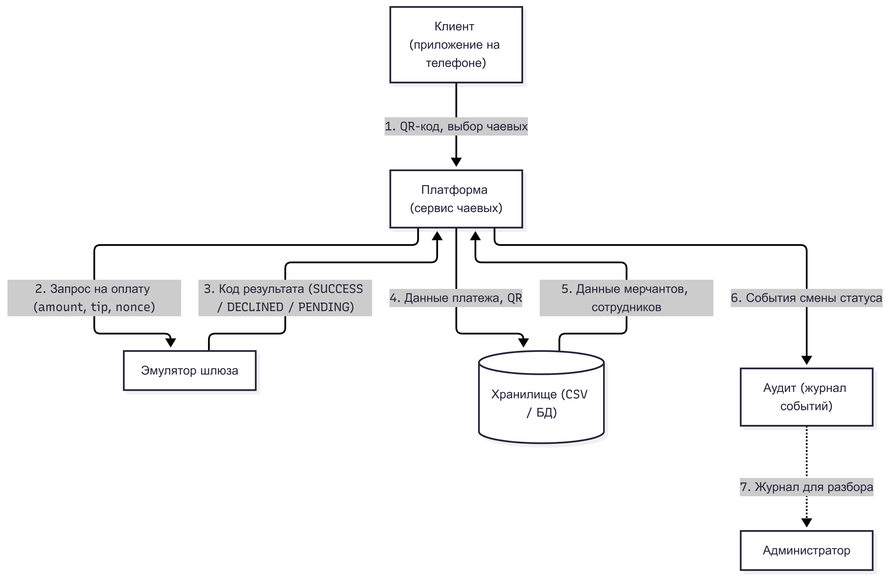
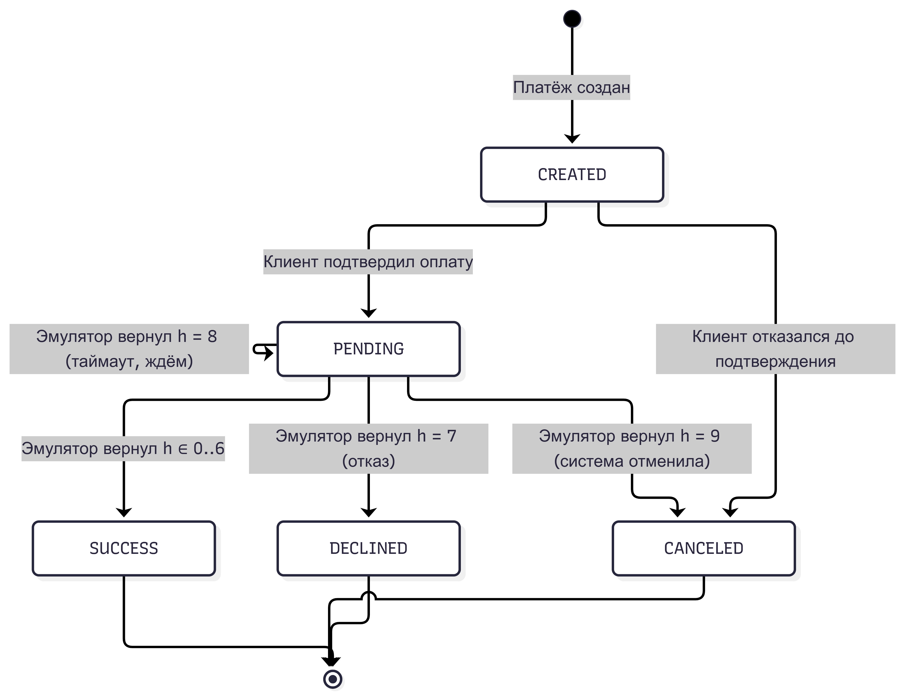
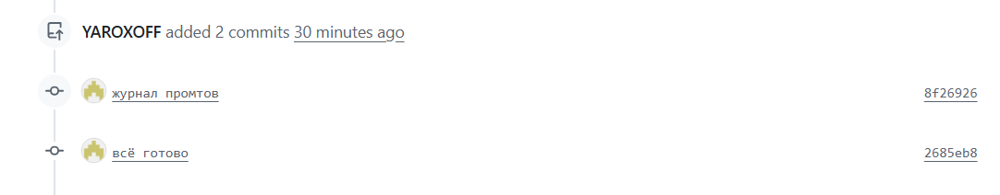
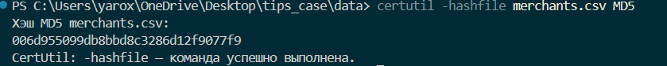

# Приложение к презентации — кейс 3 «Онлайн-чаевые»

## Как заполнять

Приложение — документ-доказательство: схемы, таблицы, тесты, журнал ИИ,
матрица вклада. Жюри читает его до защиты. Объём: 10–15 страниц.
Заполни разделы A–E. В таблицах даны 1–2 примера, остальное — «?».

## A. Диаграммы

### A.1. Схема системы (обязательно)

Нарисуйте в draw.io схему из 5–6 блоков: Клиент, Платформа, Эмулятор шлюза,
Хранилище, Аудит. Подпишите потоки данных.

|Блок|Что это|Что передаёт|
|-|-|-|
|Клиент|приложение на телефоне|QR-код, выбор чаевых|
|Платформа|сервис чаевых|Клиенту — результат оплаты; Эмулятору — запрос на оплату (amount, tip, nonce); Хранилищу — запись платежа и QR; Аудиту — события смены статуса|
|Эмулятор шлюза|имитация платёжного шлюза: h = номер qr_id mod 10 → SUCCESS / DECLINED / PENDING / CANCELED|Платформе — код результата операции (успех / отказ / таймаут / отмена)|
|Хранилище|БД платформы (merchants.csv, employees.csv, payments.csv, qr_links.csv)|Платформе — данные мерчантов, сотрудников, QR, платежей; принимает записи от Платформы|
|Аудит|журнал событий (AuditEvent)|Принимает от Платформы события смены статуса; отдаёт журнал администратору для разбора|

**Подсказка:** стрелки — это потоки: сканирование QR → валидация → создание платежа → подтверждение → результат.

### A.2. ER-модель (бонус, файл `08_errors.md`)

Вставьте диаграмму сущностей: Merchant, Employee, QR, Payment, Report, AuditEvent.
Укажите PK/FK и связи (1:N, 1:1).

> Сущности, атрибуты и связи описаны в `08_errors.md` (6 сущностей, PK/FK, связи 1:N). Сюда вставляется экспорт `er_diagram.png` из draw.io.

### A.3. Схема состояний платежа (обязательно)

Нарисуйте переходы:
CREATED → PENDING → SUCCESS / DECLINED / CANCELED
Подпишите, что переводит платёж из статуса в статус (клиент подтвердил, эмулятор вернул код, таймаут).

> Переходы:
> - CREATED → PENDING — клиент подтвердил оплату, платёж ушёл в эмулятор;
> - PENDING → SUCCESS — эмулятор вернул h ∈ 0..6;
> - PENDING → DECLINED — эмулятор вернул h = 7 (отказ);
> - PENDING → PENDING — эмулятор вернул h = 8 (таймаут, ждём и проверяем позже);
> - PENDING → CANCELED — эмулятор вернул h = 9 (система отменяет);
> - CREATED → CANCELED — клиент отказался до подтверждения.

## B. Таблицы

### B.1. Правила QR и платежа (из `02_правила.md`)

Вставьте таблицу Q-1…Q-6 и P-1…P-4 с обоснованием каждого правила.

> Таблица правил берётся из `02_правила.md` без изменений (Q-1…Q-6, P-1…P-4 с колонкой «Обоснование»).

### B.2. Матрица «ситуация → код ошибки → HTTP → retryable»

|Ситуация|Код ошибки|HTTP|retryable|
|-|-|-|-|
|Подпись QR не совпала|INVALID_QR|422|нет|
|QR истёк|QR_EXPIRED|410|да (новый QR)|
|nonce использован|QR_USED|409|нет|
|merchant BLOCKED|MERCHANT_BLOCKED|403|нет|
|Мерчант не найден|MERCHANT_NOT_FOUND|404|нет|
|Сотрудник не найден|EMPLOYEE_NOT_FOUND|404|нет|
|receipt_id не совпадает с QR|RECEIPT_MISMATCH|422|нет|
|Сумма вне диапазона|AMOUNT_OUT_OF_RANGE|422|нет|
|Чаевые вне диапазона|TIP_OUT_OF_RANGE|422|нет|
|Эмулятор вернул отказ|PAYMENT_DECLINED|402|нет|
|Таймаут эмулятора|GATEWAY_TIMEOUT|202|да (проверить статус позже)|
|Эмулятор отменил (h=9)|PAYMENT_CANCELED|409|нет (создать новый)|
|Отмена из PENDING или SUCCESS|CANCEL_NOT_ALLOWED|409|нет|
|Повтор с тем же idempotency_key|— (не ошибка, возврат копии)|200|—|

**Подсказка:** остальные ситуации — из `07_payment_emulator_template.md` §7.

### B.3. Тесты (из `03_тесты.md`)

Вставьте T3-1…T3-5 с заполненным «Факт» и «Пройден».

> Таблица тестов T3-1…T3-5 с колонками «Факт» и «Пройден» переносится из `03_тесты.md`.

## C. Журнал промптов (обязательно)

Минимум 5 строк. Формат:

|Дата|Цель|Промпт (сжато)|Результат|Проверка|Использовано|
|-|-|-|-|-|-|
|2025-11-01|Понять HMAC|«объясни HMAC на примере»|код|сверил с эталоном|да|
|2025-11-01|Проверить TTL QR|«как проверить exp в Python»|фрагмент `check_exp()`|сверил с ISO 8601 и UTC|переработано|
|2025-11-02|Эмулятор шлюза|«распределение 0–9 по md5»|функция `emulate_gateway()`|прогнал qr_001 и qr_003|да|
|2025-11-02|Идемпотентность|«как реализовать idempotency key»|схема с кэшем|сверил с P-2|переработано|
|2025-11-03|Маскирование реквизитов|«маска карты последние 4 цифры Python»|`****1234`|сверил с критерием приёмки|да|
|2025-11-03|Диаграмма состояний|«mermaid stateDiagram платежи»|схема состояний|сверил с A.3|да|

**Колонка «Использовано»:** да / нет / переработано.

## D. Матрица вклада (обязательно)

|Участник|Файлы / задачи|Часы|Подпись|
|-|-|-|-|
|Базов Я. В.|Системный аналитик: `02_roles.md`, `02_правила.md`, `03_data_dictionary.md`, `08_errors.md` (ER-модель), `05_api_schemas.yaml`, настройка Git-репозитория (ветки, коммиты) и синхронизация документации|16||
|Ефимов М. Л.|Разработчик: `code.cpp` (реализация эмулятора, HMAC-SHA256, идемпотентности), отладка C++ кода и подготовка тестовых данных|14||
|Имаев Т. Ю.|Презентация и защита: `05_презентация.md`, `06_приложение.md` (сборка PDF), подготовка слайдов и защита проекта перед жюри|10||

## E. Артефакты

* [x] Ссылка на Git-ветку: [team_6_case_3](https://github.com/YAROXOFF/tips_case/tree/team_6_case_3)
* [x] Скриншот последнего коммита: 
  
* [x] Скриншот вывода прототипа (qr_001 и qr_003)
  
  
* [x] Скриншот `md5sum merchants.csv` (данные не менялись)
  

> Пункт E закрывается только реальными артефактами: вставьте ссылку на ветку, скриншоты коммита, вывода прототипа и `md5sum`. Текстом это не подменяется.

## F. Чек-лист приложения

* [x] Схема системы: 5–6 блоков, потоки подписаны
* [x] Схема состояний платежа
* [x] ER-модель (если бонус) или перечисление сущностей
* [x] Правила Q-1…Q-6, P-1…P-4 с обоснованием
* [x] Матрица «ситуация → код → HTTP → retryable»
* [x] Тесты T3-1…T3-5 с фактом
* [x] Журнал промптов: 5+ строк
* [x] Матрица вклада: 4 человека, задачи разные
* [x] Git-ветка и коммит
* [ ] Экспорт в PDF до защиты
